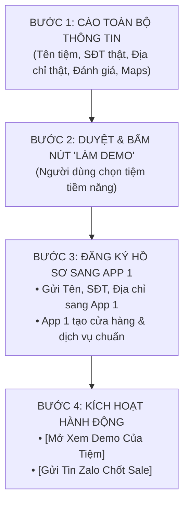

# SPEC-002: Tái Cấu Trúc App 2 (VietQR Lead Hunter) - Cỗ Máy Săn Khách & Đồng Bộ Tạo Demo Thật Sang App 1

## 1. Mục Tiêu Tối Thượng (Goal)
Thực hiện chính xác 100% theo chỉ đạo của người dùng:
**"Khi cào ra hiện rõ thông tin, lấy toàn bộ thông tin. Cửa hàng nào tôi ấn nút làm DEMO lúc này mới làm demo, trả thông tin chính xác của cửa hàng qua cho App 1 rồi mới tạo link demo. Lúc này làm đúng như 1 khách hàng cửa hàng vào App 1 để đăng ký."**

### 4 Nguyên Tắc Cốt Lõi:
1. **Thông tin bóc tách toàn diện (Full Information Display):**
   Mỗi cơ sở cào từ Google Maps hiển thị đầy đủ: Tên tiệm, Ngành nghề, Số điện thoại thật, Địa chỉ chi tiết, Đánh giá sao ⭐, Link Google Maps gốc.
2. **Quy trình 2 giai đoạn (On-Demand Provisioning):**
   Khi vừa cào về, **chưa tạo sẵn link demo**. Tiệm nào người dùng ưng ý mới bấm nút **[⚡ Làm DEMO Cho Tiệm Này]**.
3. **Đồng bộ thông tin thật sang App 1 (Authentic Store Registration):**
   Khi bấm làm Demo, hệ thống chuyển giao toàn bộ thông tin thật (Tên, SĐT, Địa chỉ, Ngành nghề) sang App 1. App 1 tạo hồ sơ kinh doanh hoàn chỉnh với các dịch vụ tương ứng, giống như một chủ tiệm thật sự vào App 1 đăng ký tài khoản.
4. **Hành động sau khi tạo Demo (One-Click Outreach):**
   Sau khi App 1 xác nhận tạo demo thành công, App 2 cập nhật link demo thật, mở ra 2 nút:
   - **[🌐 Mở Xem Demo Thật]:** Mở trang đặt lịch trên App 1 hiển thị đúng Tên tiệm, SĐT thật, Địa chỉ thật, Dịch vụ thật.
   - **[💬 Gửi Tin Zalo Chốt Sale]:** Mở Zalo tới SĐT tiệm kèm kịch bản chào hàng chứa link demo thật vừa tạo.

---

## 2. Luồng Nghiệp Vụ Tinh Gọn (The 3-Step Flow)

---

## 3. Tiêu Chí Nghiệm Thu (Acceptance Criteria)
1. Thẻ kết quả cào về hiển thị rõ ràng: Tên cửa hàng, Ngành nghề, Số điện thoại thật, Địa chỉ thật, Đánh giá sao, Link Google Maps.
2. Ban đầu thẻ tiệm ở trạng thái "Chưa tạo Web Demo", nút Làm Demo nổi bật, nút Nhắn Zalo khóa lại cho đến khi tạo xong Demo.
3. Khi bấm nút "Làm DEMO Cho Tiệm Này", hệ thống gửi thông tin thật sang App 1 đăng ký và sinh link demo thành công.
4. Sau khi tạo Demo xong, thẻ đổi trạng thái "Đã Tạo Web Demo", hiển thị link demo.
5. Bấm "Mở Xem Demo Của Tiệm" mở trang App 1 hiển thị chính xác: Tên tiệm thật, SĐT thật, Địa chỉ thật và Dịch vụ phù hợp.
6. Bấm "Gửi Tin Zalo Chốt Sale" mở Zalo tới số điện thoại thật của tiệm với kịch bản chào hàng chứa link demo vừa tạo.
